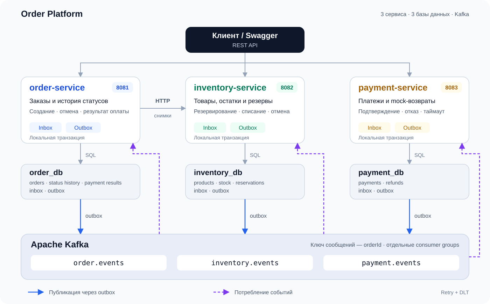
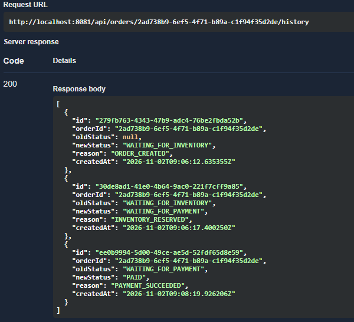
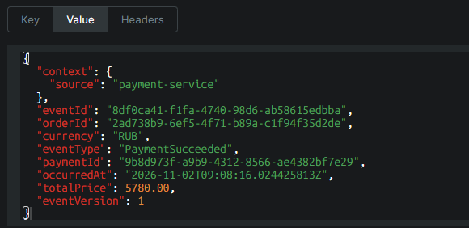
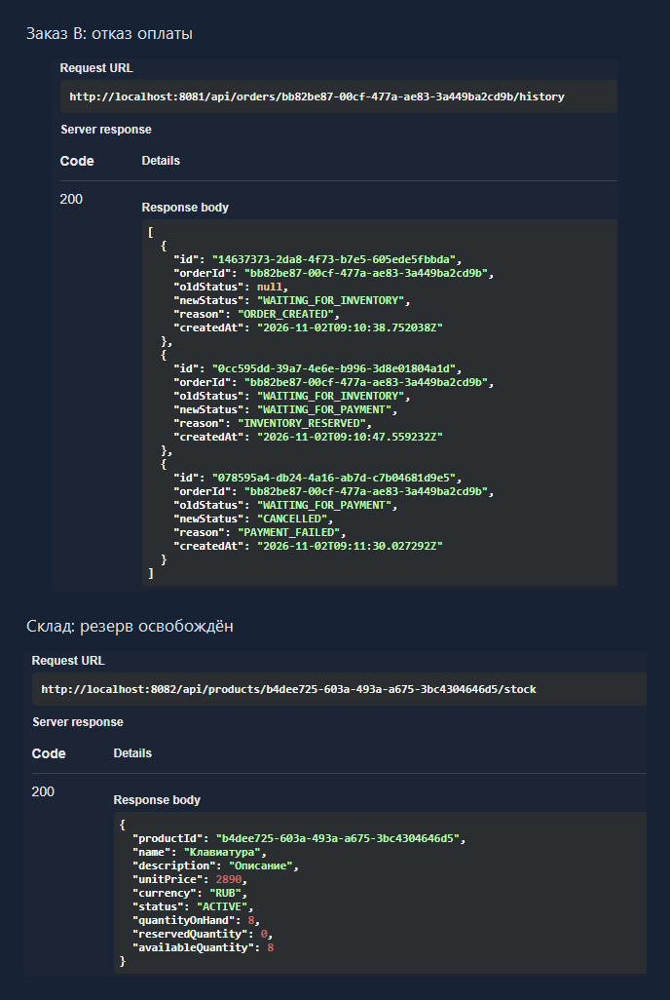

# Order Platform

[](https://github.com/vkutonov/order-platform/actions/workflows/ci.yml)

Event-driven платформа управления заказами

Java 21 · Spring Boot 4.1 · PostgreSQL · Apache Kafka · Docker Compose

Три микросервиса — заказы, склад и платежи — взаимодействуют через события Apache Kafka. 
Платформа обрабатывает полный цикл заказа: создание, резервирование товаров, оплату и списание резерва. 
При отказе оплаты, отмене или истечении срока ожидания выполняются компенсации с освобождением товаров.

[Архитектура и события](docs/architecture.md) · [Запуск, API и эксплуатация](docs/operations.md) · [Сценарии заказа](docs/demo.md)

## Что реализовано

- Создание заказа со снимком названия, цены и валюты товара на момент покупки.
- Асинхронное резервирование: недостаток товара завершает заказ бизнес-отказом.
- Автоматическое создание платежа; подтверждение и отказ доступны через REST API.
- Списание резерва после оплаты; освобождение товара при отказе, отмене и истечении срока.
- Mock-возврат, если оплата успела подтвердиться одновременно с отменой заказа.
- Каталог с остатками и мягким удалением товаров; история статусов заказа.

## Архитектура



При создании заказа `order-service` получает снимки товаров из `inventory-service`
по gRPC (`InventoryQueryService.GetProductSnapshots`, контракт — `inventory-grpc-contract`).
Резервирование, обработка оплаты и компенсации затем выполняются через Kafka.
`PAID` означает получение оплаты; списание резерва применяется асинхронно.

| Сервис | Ответственность | Swagger |
|---|---|---|
| `order-service` | Заказы, переходы статусов и история | [localhost:8081](http://localhost:8081/swagger-ui/index.html) |
| `inventory-service` | Товары, остатки и резервы | [localhost:8082](http://localhost:8082/swagger-ui/index.html) |
| `payment-service` | Платежи, срок оплаты и mock-возвраты | [localhost:8083](http://localhost:8083/swagger-ui/index.html) |

[Kafka UI](http://localhost:8085) позволяет просматривать события и consumer groups.
Адреса указаны для портов из `.env.example`.

## Быстрый запуск

Нужен запущенный Docker Engine или Docker Desktop с Docker Compose v2.
Команды выполняются из корня проекта. Если `.env` уже существует, пропустите копирование.

**Windows / PowerShell**

```powershell
Copy-Item .env.example .env
docker compose up -d --build --wait
```

<details>
<summary>Linux / macOS</summary>

```bash
cp .env.example .env
docker compose up -d --build --wait
```

</details>

Первый запуск включает сборку образов и загрузку зависимостей.
PostgreSQL и Kafka поднимаются вместе с приложениями; Flyway применяет миграции автоматически.

Проверить состояние:

```powershell
docker compose ps
```

[Запуск из IDE, переменные окружения и пересборка контейнеров](docs/operations.md).

## Попробовать флоу заказа

Все шаги доступны через Swagger. Создавать платёж или публиковать Kafka-события вручную не требуется.

**1. Создайте товар** через `POST /api/products` на `8082`:

```json
{
  "name": "Клавиатура",
  "description": "Описание",
  "unitPrice": 2890.00,
  "currency": "RUB",
  "quantityOnHand": 10
}
```

**2. Скопируйте `id` товара из ответа и создайте заказ** через `POST /api/orders` на `8081`.
Замените `<productId>` реальным UUID:

```json
{
  "userId": "3fa85f64-5717-4562-b3fc-2c963f66afa6",
  "items": [
    {
      "productId": "<productId>",
      "quantity": 2
    }
  ]
}
```

**3. Дождитесь готовности к оплате.** В `GET /api/orders/{id}` появится
`WAITING_FOR_PAYMENT`. Затем найдите платёж с этим `orderId` в `GET /api/payments` на `8083`.

**4. Подтвердите оплату** через `POST /api/payments/by-order/{orderId}/confirm` на `8083`.
Тело запроса не нужно.

**5. Проверьте итог.** Обновите `GET /api/orders/{id}`, историю заказа
`GET /api/orders/{id}/history` и остаток `GET /api/products/{id}/stock`:

| Объект | Ожидаемый результат |
|---|---|
| Заказ | `PAID`, в истории — `PAYMENT_SUCCEEDED` |
| Платёж | `SUCCEEDED`, сумма `5780.00 RUB` |
| Товар | `quantityOnHand = 8`, `reservedQuantity = 0`, `availableQuantity = 8` |

События доставляются асинхронно: итог может появиться после нескольких обновлений ответа.

Для проверки компенсации создайте **ещё один заказ** на две единицы того же товара
и вызовите `/reject` вместо `/confirm`. Дождитесь `CANCELLED`: после освобождения
второго резерва остаток снова будет `8 / 0 / 8`.

[Сценарии оплаты, отказа, ручной отмены и истечения срока](docs/demo.md).

<details>
<summary>Демонстрация в Swagger и Kafka UI</summary>

**1. Успешный заказ.** История заказа с `PAID` и причиной `PAYMENT_SUCCEEDED`.

Заказ A: `2ad738b9-6ef5-4f71-b89a-c1f94f35d2de`.



**2. Событие оплаты.** `PaymentSucceeded` в Kafka UI: тот же `orderId A`,
сумма `5780.00 RUB` и собственный `paymentId`.



**3. Компенсация.** Второй заказ `CANCELLED` и товар с освобождённым резервом:
`quantityOnHand = 8`, `reservedQuantity = 0`, `availableQuantity = 8`.

Заказ B: `bb82be87-00cf-477a-ae83-3a449ba2cd9b`. Две единицы, купленные в заказе A,
уже списаны; после отказа заказа B его резерв освобождён.



</details>

## Надёжность и обработка сбоев

| Ситуация | Поведение системы |
|---|---|
| Процесс упал после сохранения бизнес-данных, до отправки в Kafka | Событие остаётся в outbox и будет отправлено после восстановления |
| Kafka повторно доставила сообщение | Inbox проверяет `eventId`; обработчики также учитывают уже сохранённые бизнес-результаты |
| Отмена доставлена раньше создания резерва или платежа | Сохранённая отмена предотвращает позднее открытие операции |
| Оплата и отмена произошли одновременно | Заказ сохраняет выбранный итог; успешная оплата отменённого заказа компенсируется mock-возвратом |
| Техническая ошибка при обработке | Локальная транзакция откатывается, выполняются retry; после их исчерпания сообщение попадает в DLT |

Доставка — `at-least-once`. Outbox, inbox и проверки переходов состояний защищают
бизнес-операции от повторного применения. Строгий порядок публикации из outbox не гарантируется.

[Границы транзакций, блокировки и контракт событий](docs/architecture.md).

## Тесты и CI

Для локальных тестов нужны JDK 21 и запущенный Docker: интеграционные сценарии
используют настоящие PostgreSQL через Testcontainers и встроенный Kafka broker.

```powershell
.\gradlew.bat build
```

Для Linux/macOS: `./gradlew build`.

Тесты проверяют переходы статусов, REST API, миграции, повторную доставку,
конкурентную обработку, компенсации и откат транзакций.

GitHub Actions запускает сборку и тесты каждого из трёх сервисов.
Отдельный Docker job проверяет Compose, собирает образы и ожидает готовности приложений.
Он проверяет запуск; сквозной бизнес-сценарий пока не автоматизирован в этом job.

## Границы текущей версии

- Платежи и возвраты имитируются локально; реальных списаний нет.
- Авторизация не подключена, включая административные операции подтверждения и отказа.
- На заказ создаётся одна попытка оплаты; отказ или истечение срока отменяет заказ.
- Повторный `POST /api/orders` может создать новый заказ: идемпотентность HTTP-создания пока не реализована.
- В списках товаров и платежей нет пагинации.
- Разбор сообщений из DLT выполняется вручную; очистка outbox/inbox пока не автоматизирована.

Дальнейшее развитие: авторизация, реальный платёжный провайдер, сквозной сценарий в CI
и наблюдаемость. Отдельный сервис уведомлений не требуется для завершения текущего флоу.
