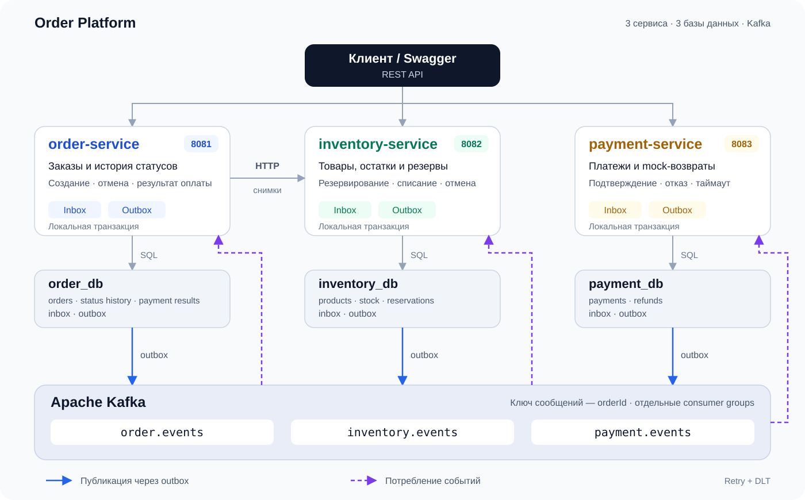

# Архитектура и события

[К README](../README.md) · [Запуск и API](operations.md) · [Демо](demo.md)

## Границы сервисов

Каждый сервис владеет своей PostgreSQL и выполняет локальные транзакции.
`order-service` хранит снимки позиций заказа, а актуальные товары и остатки принадлежат
`inventory-service`. При создании заказа снимки получаются синхронно по gRPC
(`InventoryQueryService.GetProductSnapshots` из `inventory-grpc-contract`). Снимок содержит
название, цену, валюту и статус товара; резервирование остатков выполняется через Kafka.

Deadline запроса snapshots — 3 секунды. `NOT_FOUND` передаёт точные отсутствующие UUID
в protobuf-сообщении `MissingProducts` через бинарный trailer `missing-products-bin`.
Order преобразует его в REST `404 / PRODUCT_NOT_FOUND` с `missingProductIds`.
`UNAVAILABLE` возвращается как HTTP 503, `DEADLINE_EXCEEDED` — 504,
остальные ошибки зависимости — 502. При ошибке получения snapshots заказ не сохраняется.

Для последующих шагов используются события Kafka. Состояния разных сервисов
согласуются постепенно: например, `PAID` уже может быть сохранён, пока склад
ещё обрабатывает `OrderPaidEvent`.

| Сервис | Основные данные |
|---|---|
| order-service | Заказы, позиции, история статусов, результаты платежей, inbox и outbox |
| inventory-service | Товары, остатки, резервы и их позиции, inbox и outbox |
| payment-service | Платежи, возвраты, inbox и outbox |

## События

Во всех трёх основных топиках ключ сообщения — строковый `orderId`.
Изменение состояния и соответствующее исходящее событие сохраняются в одной
транзакции БД, а публикацию выполняет outbox publisher.

| Топик | Тип события | Обработчик и результат |
|---|---|---|
| `order.events` | `OrderCreatedEvent` | Inventory создаёт резерв |
| `inventory.events` | `InventoryReservedEvent` | Order переходит в `WAITING_FOR_PAYMENT` и выпускает готовность к оплате |
| `inventory.events` | `InventoryReservationFailedEvent` | Order отменяется и выпускает событие отмены |
| `order.events` | `OrderReadyForPaymentEvent` | Payment создаёт платёж или возвращает существующую попытку |
| `payment.events` | `PaymentSucceeded` | Order переходит в `PAID` и выпускает `OrderPaidEvent` |
| `payment.events` | `PaymentFailed` | Order переходит в `CANCELLED` и выпускает `OrderCancelledEvent` |
| `order.events` | `OrderPaidEvent` | Inventory списывает резерв и товар |
| `order.events` | `OrderCancelledEvent` | Inventory освобождает резерв; Payment закрывает платёж либо оформляет mock-возврат |
| `payment.events` | `PaymentRefunded` | Факт mock-возврата опубликован; Order пропускает его без изменения состояния |

Существуют только три основных топика: `order.events`, `inventory.events` и `payment.events`.
Отдельный `payment.commands` текущему флоу не нужен.

Группы потребителей:

| Сервис / поток | Consumer group |
|---|---|
| Inventory: события заказа | `inventory-order-created-v1` |
| Payment: события заказа | `payment-order-events-v1` |
| Order: результат резервирования | `order-inventory-reservation-v1` |
| Order: результат оплаты | `order-payment-results-v1` |

Контракт версии 1 содержит `eventId`, `eventType`, `eventVersion`, `orderId` и `occurredAt`.
Состав бизнес-полей зависит от события. Готовность к оплате передаёт также `userId`,
`totalPrice`, `currency` и `context`; сумма и валюта берутся из сохранённого заказа.

`OrderPaidEvent` и `OrderCancelledEvent` имеют одинаковую структуру и представлены
локальным record `OrderLifecycleEvent` в каждом сервисе. Общей Java-библиотеки Kafka-контрактов нет.
Тип сообщения определяется полем `eventType`; `OrderLifecycleEvent` не является отдельным типом события Kafka.

## Платёж и компенсации

Платёж имеет собственный UUID `paymentId`, отличный от `eventId`.
Сейчас у заказа одна попытка — `attemptNumber = 1`. Повторная готовность с теми же
пользователем, суммой и валютой возвращает её; конфликт данных считается ошибкой контракта.

Переходы платежа: `PENDING → SUCCEEDED` или `PENDING → FAILED`.
Оба результата окончательны. Повторное подтверждение или отказ возвращает сохранённый
результат без нового события, в том числе при запросе противоположного действия.

| Причина завершения | Код платежа | Дальнейшее действие |
|---|---|---|
| Ручной отказ | `DECLINED` | Заказ отменяется, товар освобождается |
| Истечение срока | `SESSION_EXPIRED` | Заказ отменяется, товар освобождается |
| Отмена заказа | `ORDER_CANCELLED` | Ожидающий платёж закрывается |

Срок рассчитывается от `occurredAt` готовности к оплате и по умолчанию составляет 15 минут.
Если сообщение уже просрочено при доставке, создаётся сразу неуспешный платёж.
Scheduler проверяет просроченные `PENDING` с интервалом 10 секунд, выбирает до 50 записей
и завершает каждую отдельной транзакцией. Подтверждение само проверяет срок,
поэтому не ждёт следующего запуска scheduler.

Ручная отмена заказа допустима до `PAID`. Повторная отмена `CANCELLED` не создаёт новую
историю и событие. Поздний результат склада не открывает отменённый заказ обратно.

Если платёж успел стать `SUCCEEDED` до доставки отмены, Payment создаёт один
успешный mock-возврат в `refunds` и событие `PaymentRefunded`. Исходный платёж
остаётся `SUCCEEDED` как факт оплаты. Order сохраняет поздний финансовый результат,
оставляет заказ `CANCELLED` и повторно выпускает отмену для запуска компенсации.
Отдельный статус возврата в заказ не добавлен.

В inventory после оплаты резерв становится `COMMITTED`: уменьшаются и общий остаток,
и резерв. При отмене он становится `RELEASED`: уменьшается только резерв.
Освобождение сейчас запускает отмена заказа; отдельного scheduler истечения резервов нет.

## Транзакции и защита от повторов

- Order сохраняет результат оплаты, inbox, статус заказа, историю и исходящий outbox атомарно.
- Inventory сохраняет входящее событие и изменение резерва/остатков в одной транзакции.
  При создании резерва туда же входит событие результата.
- Payment атомарно сохраняет создание платежа с inbox, а завершение платежа или возврат — с outbox.

Inbox подавляет повторы по `eventId`. Дополнительно проверяются состояния резерва,
платежа и сохранённый результат по `paymentId`. Новый `eventId` не позволяет
повторно списать товар или применить конфликтующий итог одного платежа.
Order проверяет также сумму и валюту результата оплаты.

Для существующего заказа и завершаемого платежа используются блокировки строк.
Остатки склада защищены optimistic locking через `@Version`.

В обработчиках создания и отмены Inventory и Payment дополнительно берётся
`pg_advisory_xact_lock` по хешу `orderId`. Это позволяет согласовать операции,
даже когда строки платежа или резерва ещё нет. Блокировка освобождается при commit
или rollback и действует только в своей БД.

Отмена, пришедшая раньше создания, остаётся в inbox. Позднее событие проверяет её
и не открывает резерв или успешную попытку оплаты. Поэтому записи отмены нельзя
просто удалить общей очисткой inbox без сохранения постоянного признака отмены.

Для этих проверок добавлен индекс `processed_events(aggregate_id, event_type)`.
Частичный индекс платежей `(expires_at, id) WHERE status = 'PENDING'` поддерживает
поиск просроченных ожидающих платежей.

## Доставка и обработка ошибок

Outbox обеспечивает повторную отправку после сбоев. Сообщения пакета публикуются
асинхронно; результаты обрабатываются по отдельности после ответа Kafka.
Poller ждёт завершения пакета перед следующим циклом.

| Параметр | Текущее значение |
|---|---|
| Размер пакета outbox | 50 |
| Интервал poller | 5 секунд |
| Executor обработки результатов | 2 потока, очередь размером с пакет |
| Kafka delivery timeout | 30 секунд |
| Kafka request timeout | 10 секунд |
| Ожидание метаданных / буфера producer | До 5 секунд на вызов |
| Возврат зависшего `PROCESSING` | Через 60 секунд |
| Retry consumer | 2 повтора с интервалом 2 секунды |

Возврат `PROCESSING` учитывает всю обработку, включая ожидание БД.
При сбое после отправки, но до отметки `PUBLISHED` возможна повторная публикация.
Это `at-least-once`; producer idempotence не заменяет inbox и бизнес-проверки.

Одинаковый Kafka-ключ выбирает одну partition, но не исправляет перестановку,
возникшую до публикации из параллельных outbox-задач. Обработчики учитывают
окончательные состояния и раннюю отмену.

Недостаток товара — бизнес-результат, а не техническая ошибка для retry.
Ошибки контракта идут в DLT без повторов; временные ошибки после исчерпания retry —
тоже в DLT. Список топиков и порядок разбора описаны в [эксплуатации](operations.md).

## Где смотреть реализацию

- [Order: результат оплаты и исходящие события](../order-service/src/main/java/com/valentin/orderservice/logic/PaymentEventHandler.java).
- [Inventory: завершение и освобождение резерва](../inventory-service/src/main/java/com/valentin/inventoryservice/logic/OrderLifecycleEventHandler.java).
- [Payment: подтверждение, отказ, истечение срока и возврат](../payment-service/src/main/java/com/valentin/paymentservice/logic/PaymentService.java).
