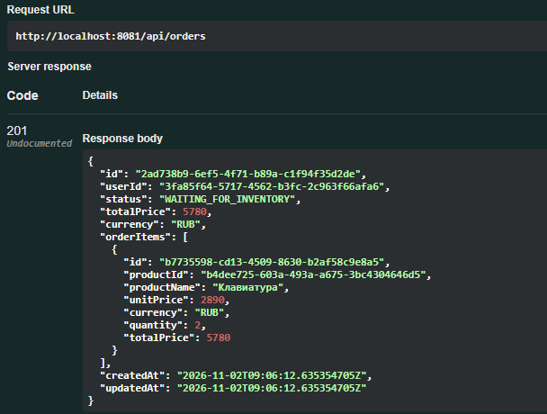
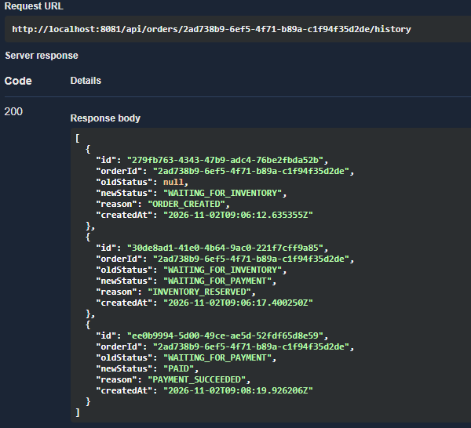
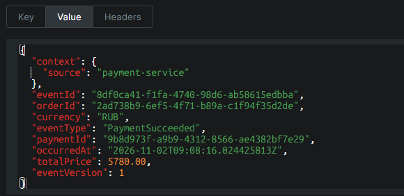
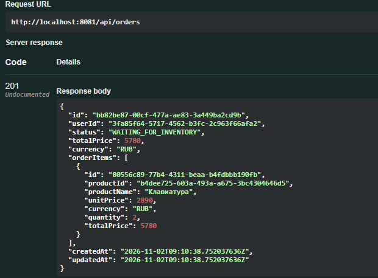
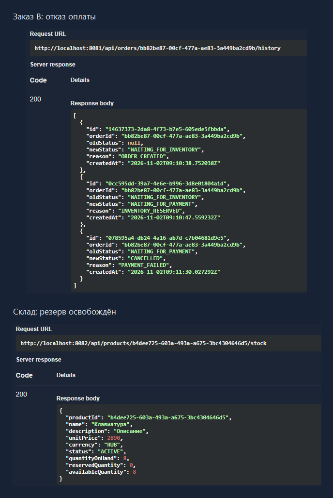

# Сценарии заказа

[К README](../README.md) · [API](operations.md) · [Архитектура](architecture.md)

Основной сценарий использует один товар и два заказа. Первый оплачивается,
второй отклоняется. Оплата имитируется локально.

## Исходные данные

Примеры создания товара и заказа приведены в [README](../README.md).

| Объект | Значение |
|---|---|
| Товар | Клавиатура, `2890.00 RUB` за единицу |
| Начальный остаток товара | `10` |
| Количество в каждом заказе | `2` |
| Сумма каждого заказа | `5780.00 RUB` |
| Заказ A | `2ad738b9-6ef5-4f71-b89a-c1f94f35d2de` — успешная оплата |
| Заказ B | `bb82be87-00cf-477a-ae83-3a449ba2cd9b` — отказ оплаты и освобождение резерва |

На скриншотах приведён один выполненный прогон. UUID товара —
`b4dee725-603a-493a-a675-3bc4304646d5`; `orderId A` и `orderId B` — UUID соответствующих заказов.
При повторном прогоне приложение генерирует новые идентификаторы.
Демонстрационные `userId` не требуют предварительной регистрации: авторизация и проверка пользователя пока не подключены.

## Успешная оплата

| Шаг | Запрос или событие | Результат |
|---|---|---|
| Создание заказа A | `POST /api/orders` | `WAITING_FOR_INVENTORY` |
| Результат резервирования | `InventoryReservedEvent` | Заказ `WAITING_FOR_PAYMENT`; остаток `10 / 2 / 8` |
| Готовность к оплате | `OrderReadyForPaymentEvent` | В `GET /api/payments` появляется платёж заказа A |
| Подтверждение | `POST /api/payments/by-order/{orderId}/confirm` | Платёж `SUCCEEDED` |
| Применение результата оплаты | `PaymentSucceeded` | Заказ `PAID`; в истории — `PAYMENT_SUCCEEDED` |
| Списание резерва | `OrderPaidEvent` | Остаток `8 / 0 / 8` |

Числа остатков указаны в порядке `quantityOnHand / reservedQuantity / availableQuantity`.
Состояние заказа доступно через `GET /api/orders/{id}`, история — через
`GET /api/orders/{id}/history`, остаток — через `GET /api/products/{id}/stock`.

Создание платежа и изменение состояний асинхронны. Платёж может появиться чуть позже
перехода заказа в `WAITING_FOR_PAYMENT`. Outbox poller работает с интервалом 5 секунд;
ответ Swagger отражает состояние на момент запроса.

### Создание заказа A — HTTP 201

Заказ создан в `WAITING_FOR_INVENTORY`. Снимок позиции содержит тот же товар,
две единицы по `2890.00 RUB` и итог `5780.00 RUB`.

### История оплаченного заказа

Тот же заказ A проходит `WAITING_FOR_INVENTORY → WAITING_FOR_PAYMENT → PAID`.
Последняя запись истории содержит причину `PAYMENT_SUCCEEDED`.

### Результат оплаты в Kafka

Сообщение `PaymentSucceeded` содержит тот же `orderId A`, собственный `paymentId`
и сумму `5780.00 RUB`. Оно публикуется в `payment.events`.
После применения результата Order выпускает `OrderPaidEvent` в `order.events`.

## Отказ и освобождение товара

Заказ B создаётся на две единицы того же товара после завершения заказа A.

| Шаг | Запрос или событие | Результат |
|---|---|---|
| Создание и резервирование заказа B | `POST /api/orders`, затем `InventoryReservedEvent` | `WAITING_FOR_PAYMENT`; остаток `8 / 2 / 6` |
| Отказ | `POST /api/payments/by-order/{orderId}/reject` | Платёж `FAILED / DECLINED` |
| Применение отказа | `PaymentFailed` | Заказ `CANCELLED`; в истории — `PAYMENT_FAILED` |
| Освобождение резерва | `OrderCancelledEvent` | Остаток `8 / 0 / 8` |

### Создание заказа B — HTTP 201

Отдельный заказ на тот же товар и количество; его UUID совпадает с историей отмены.

### Отмена заказа и освобождение резерва

История заказа B завершается статусом `CANCELLED` с причиной `PAYMENT_FAILED`.
На складе остаётся `8` единиц, резерв равен `0`, доступный остаток — `8`.
Две единицы из заказа A уже списаны, а резерв заказа B освобождён.

Событие `PaymentFailed` для заказа B публикуется в `payment.events`,
`OrderCancelledEvent` — в `order.events`.
Повторное подтверждение этой попытки возвращает сохранённый `FAILED`.

## Другие сценарии

| Проверка | Запрос или условие | Ожидаемый итог |
|---|---|---|
| Ручная отмена | `POST /api/orders/{id}/cancel` для нового ожидающего заказа | Заказ `CANCELLED`, товар освобождён, ожидающий платёж закрыт с `ORDER_CANCELLED` |
| Истечение срока | Новый платёж остаётся без подтверждения до `expiresAt` | `FAILED / SESSION_EXPIRED`, затем отмена заказа и освобождение товара |
| Повтор подтверждения | `confirm` для уже оплаченного заказа A | Тот же платёж `SUCCEEDED`, без нового результата |
| Недостаток товара | Новый заказ с количеством выше доступного остатка | `CANCELLED`, причина в истории — `INVENTORY_INSUFFICIENT_STOCK` |

По умолчанию срок оплаты — 15 минут, scheduler проверяет истечение с интервалом 10 секунд.
На изменение заказа и склада требуется также доставка событий.

Гонка подтверждения с отменой покрыта сценарными тестами: успешный платёж отменённого
заказа компенсируется mock-возвратом. Заказ остаётся `CANCELLED`,
платёж — `SUCCEEDED`, факт возврата сохраняется отдельно в `refunds`.
